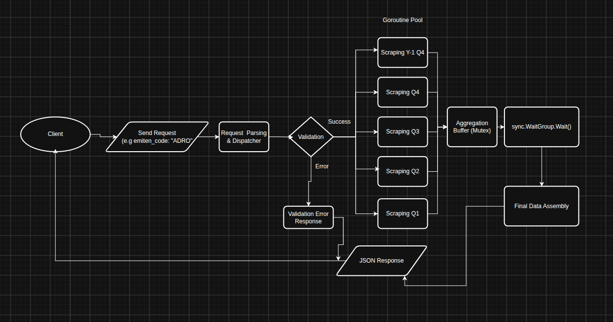

# FRAS - Financial Statement Analyzer

## Problem
It's hassle to check financial statement one by one. And also i hvae to count manually about the financial metris such as RoE (Returnn on Equity), Net Income, Total Revenuew, and much more.

## Solution
So i build a financial statement analyzer to solve the problem. The system works by scraping the finanial report XBRL (eXtensible Business Reporting Language) from IDX Website using Golang (I know it's illegal so this is just educational purpose). Then the system will process to generate goroutine as many as the quarter needs to received. To solve race ondition, mutex is my solution. WaitGroup waits the system to receive all the goroutine information before sending that to the client.

## FAQ

## Why use the Golang instead of Python?
Generally, i have used Python as my first scraper system. But the system take's a long time (almost 20 second). After i check, i learn that python is single-threaded (even if it can be a multi-threaded) and not oficially take a multi-threaded one like C++ or Golang. So i switched up to Golang and also it's a good reason because Golang has a goroutine system that fits my criteria because it speed. And the result is, i can decrease the system time into 75%! (or ~3 to 5 second!).

And i like to use it because it's near to memory level so i can have a good understanding in memory level.

## Why this project is incompleted "intentionally"?
I realize after try with different stock name, the XBRL strucrure changed. And it would take me a lot of time to work in that scenario. And also the IDX confirms in their terms page, that scraping is illegal, so i can just use this system as a educational purpose.
